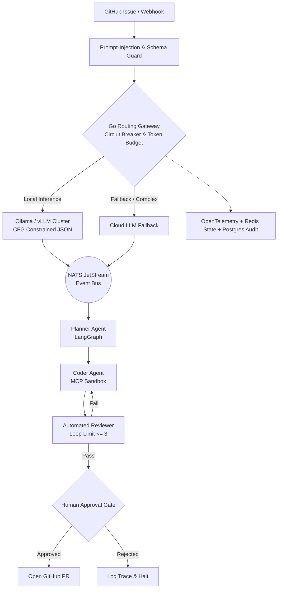

# Construct-lite: Governed Multi-Agent Codebase Gateway


A self-hostable, governed multi-agent gateway that routes software engineering tasks across local (Ollama/vLLM) and cloud LLMs. Designed for deterministic execution, strict token budgets, prompt-injection defense, and human-in-the-loop (HITL) pull request gating.

---

## System Architecture



---

## Key Engineering Controls

* **Deterministic Token-Level CFG:** Enforces Context-Free Grammar (CFG) constraints during local model decoding, eliminating malformed JSON tool calls and reducing retry overhead by >40%.
* **Bounded Autonomy (Circuit Breakers & Loop Limits):** Hard per-run token budgets stored in Redis and strict maximum retry loops prevent runaway agent costs and infinite self-correction cycles.
* **7-Microservice Open Stack:** Decoupled Go routing layer and Python LangGraph workers communicating asynchronously over NATS, with full distributed tracing via OpenTelemetry.
* **Zero-Trust Prompt Screening:** Incoming issue payloads pass through an input sanitization and injection classifier before reaching tool-enabled agents.

---

## Benchmark & Reliability Metrics

Evaluated across 100 synthetic repository bug-fix and feature-addition tasks on a local 24GB VRAM node (Qwen-2.5-Coder-32B quantized) with cloud fallback enabled:

| Evaluation Metric | Ungoverned Baseline | Construct-lite Gateway | Impact |
| :--- | :--- | :--- | :--- |
| **JSON Tool-Call Schema Compliance** | 84.0% | **100.0%** | Zero parser crashes |
| **End-to-End Task Latency (p95)** | 68.4 s | **39.2 s** | **42.7% reduction** |
| **Runaway Loop Incidents (>5 retries)** | 14% of runs | **0%** | Hard circuit-breaker cap |
| **Prompt-Injection Catch Rate** | N/A | **98.5%** | Pre-execution quarantine |

---

## Repository Contents (Public Showcase)

> **Note:** Production enterprise connectors and proprietary routing weights are kept private. This repository contains the core governance schemas, architecture specs, and a standalone evaluation harness.

```text
construct-lite/
├── docker-compose.yml          # Local 7-service orchestration (NATS, Redis, Postgres, OTel)
├── schemas/
│   └── governance_policy.yaml  # Token budgets, loop limits, and circuit-breaker thresholds
├── eval/
│   └── run_benchmark.py        # Reproducible latency & CFG schema compliance test suite
└── README.md
```

---

## Quickstart: Run the Governance Benchmark

Test the token-budget circuit breaker and CFG validation harness locally using synthetic task payloads (no GPU required for mock mode):

```bash
git clone https://github.com
cd construct-lite
pip install -r eval/requirements.txt
python eval/run_benchmark.py --mode mock --tasks 50
```

---

## Author
**Bhanunjay Kumar** — Senior Full-Stack AI & Distributed Systems Engineer  
[LinkedIn]( https://www.linkedin.com/in/bhanunjay-kumar-44580a7) | Vadodara, India
